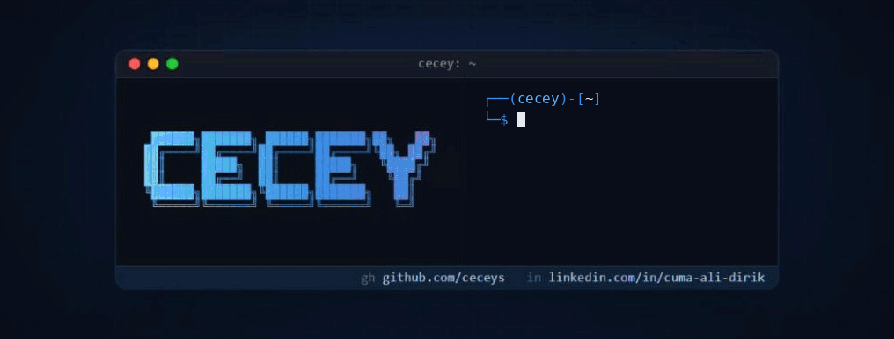

  <picture>
    <source media="(max-width: 900px)" srcset="https://github.com/ceceys/ceceys/raw/main/cecey-mobile.gif">
    
  </picture>

# Cuma Ali Dirik (cecey)

I work in software and IT in Istanbul. I like writing tools for the problems I run into at work, and I share some of them as open source. Below are those, along with some of the other things I have worked on.

[Türkçe](README.tr.md)

## How I work

- **I don't touch the source.** My tools copy or read data and leave the original as it is.
- **Every step can be undone.** Moves and changes are logged so they can be rolled back.
- **Not done until it's verified.** I compare counts, check files with SHA-256 and test output against real samples.
- **Data stays with the user.** No telemetry, and updates are never installed without asking.

## Open source

| Project | What it does | Built with |
|---|---|---|
| [Mandal](https://github.com/ceceys/mandal) | A clothesline for screenshots and notes on Windows: capture, pin, copy, OCR and per-item shortcuts. | C#, WPF, .NET 8, Windows OCR, Inno Setup, GitHub Actions |
| [SWIFT PDF](https://github.com/ceceys/swift-pdf) | Turns Kuveyt Türk outgoing transfer e-mails into a one-page A4 PDF that holds only the raw SWIFT text. **Impact:** A manual job now takes a few seconds; correct in 298 of 298 test PDFs. | C#, WPF, .NET 8, PdfPig, WebView2 |
| [Mail Aktarıcı](https://github.com/ceceys/mail-aktarici) | Copies every Outlook account, PST archive and IMAP/POP3 mailbox into one folder without touching the source, and checks the counts. | C#, WinForms, .NET Framework 4, Outlook COM |
| [Dijital Gözetleme Kulesi](https://github.com/ceceys/dijital-gozetleme-kulesi) | WatchTower: checks uptime, HTTP status, SSL expiry and domain expiry of websites every day. **Impact:** A daily manual site check became automatic. | VB.NET, WHOIS |

## In-house software

| Project | What it does | Built with |
|---|---|---|
| Help desk | Tickets, asset handover forms and daily reporting in one place. **Impact:** In daily use; 90% faster after a performance fix. | PHP 8, MariaDB, Tailwind CSS, Chart.js, Gemini API |
| Customer statement mailer | Prepares and sends account statements from one screen with preview and approval. **Impact:** Replaced a manual task. | PHP, MariaDB |
| Newsletter and bulk mail | Sends personalized newsletters with unsubscribe links and rate limits. **Impact:** Removed a 30–50k TL/year mailing cost. | PHP, cron, SPF / DKIM / DMARC |
| News and blog bot | Scans chosen sources and drafts original articles with images for the site. **Impact:** Does the job of a ~$75/month service at zero cost. | PHP, Gemini API |
| PDF translator | Translates foreign-language PDFs into Turkish, laying the translation over the original page layout. **Impact:** No page limit, same day; no need for outside translation services. | PHP, Python, Gemini API |
| Office chat | Single-room team chat with image and GIF sharing. | PHP, MariaDB, JavaScript |
| Accident claim calculator (in progress) | Calculates loss of use, diminished value and damage in traffic accident cases, produces an expert-report style PDF and finds precedent decisions. | PHP 8.2, MariaDB, mPDF, PhpSpreadsheet, Gemini API, Tailwind |

## Automation

| Project | What it does | Built with |
|---|---|---|
| Accounting archive organizer | Sorts accounting files by what is inside them (OCR included) and keeps every move reversible. **Impact:** 32,368 files reorganized; SHA-256 check: nothing lost. | Python, Tesseract OCR, SQLite, PowerShell |
| Social media pipeline | Produces posts, stories, Reels and X threads from source documents, drops any number that is not in the source, queues them for approval and publishes the approved ones on schedule. **Impact:** One brand's queue went from 0.1 to 1.8 days of posts. | Python, PHP, Meta APIs, Claude |
| Search Console tool | Adds domains to Google Search Console, verifies them through DNS, submits sitemaps and pulls click data. **Impact:** Sitemaps and verification automated across sites. | Python, Search Console API, Cloudflare API |
| Domain expiry calendar | Reads expiry dates from whois and RDAP into a sorted table. **Impact:** Expiry dates of all managed domains tracked in one place. | Python, whois, RDAP |
| Outlook mailbox cleanup | Sorting rules and a by-year archive for classic Outlook. **Impact:** Inbox 6,110 → 37. | Outlook COM automation |

## Websites

Built or rebuilt from scratch, most with their own admin panel.

| Site | What it is | Built with |
|---|---|---|
| Company website | Admin panel and content rebuilt, SEO renewed. **Impact:** 87 pages rewritten. | PHP, Tailwind |
| Multilingual corporate site | Content entered in Turkish is translated into three other languages automatically. | PHP, MySQL, Gemini |
| Blog platform | Articles published from an admin panel; a new version is in progress. | PHP, MySQL, Tailwind |
| Bilingual product catalogue | Sectors, products and projects come from a database. | PHP, MySQL |
| Restaurant site | Rebuilt from scratch to replace an old WordPress site. **Impact:** Yearly running cost −60%. | PHP, MySQL |
| Small business sites | Quote forms with photo upload, admin panels and structured data for manufacturing and workshop businesses. **Impact:** One site 324 MB → 28 MB; LCP 1.9 s on slow 4G. | PHP, MariaDB, Python, Playwright, JSON-LD |
| Service management app | Service intake, sales and stock with customer notifications for a repair shop. | PHP, MariaDB, Tailwind |
| Restaurant order system | Kitchen display, tables, menu, stock, QR menu and receipt printer. | PHP, MySQL, Tailwind, Chart.js, ESC/POS |

<b>Experiments and past projects</b>

| Project | What it does | Built with |
|---|---|---|
| Domiva | Multiplayer browser strategy game with villages, armies, clans and battles. | PHP, MySQL, JavaScript |
| Intern training game | Windows 95 themed detective game in six chapters, sent to interns as a puzzle. | — |
| Nexus | Multi-agent "virtual IT department" that splits work between manager, network, sysadmin and analyst agents. | Python, CrewAI, FastAPI, ChromaDB |
| Trading signal study | Rule-based demo trading bot and a listener that measured a Telegram signal channel; in a placebo test random entries beat the channel's signals. | Python, MetaTrader 5, SQLite |
| Purchasing app | Collects supplier quotes, compares prices and tracks orders and deliveries. | C# WinForms, later PHP |

<b>Small tools</b>

- Local Turkish speech-to-text tool (Python, faster-whisper)
- Trademark infringement evidence collector with screenshots and SHA-256 (Python)
- Instagram archiver and Reels generator (Python, Meta Graph API)
- Keyword harvester from Google autocomplete (Python)
- Sitemap serving with Cloudflare Workers (JavaScript)
- Reversible folder reorganization scripts (Python)
- Holiday calendar and exchange-rate bar widgets (HTML, JavaScript)

<b>For the curious, all my skills</b>

| Area | Skills |
|---|---|
| **Software development** | **Languages:** Python (advanced), C, C++, C#, Java, Go, Rust, Kotlin, Dart, PHP, VB.NET, JavaScript, TypeScript, MQL5 **Desktop:** .NET, WPF, XAML **Web:** React, Vue, Next.js, Laravel, Node.js, FastAPI **Databases:** MySQL, MSSQL, NoSQL **Scripting:** PowerShell, Bash, Batch, VBA, Lua **Tools:** Git, GitHub, Docker |
| **Systems and infrastructure** | **Servers:** Windows Server, IIS, Active Directory **Linux:** Debian, Ubuntu, Arch Linux **Virtualization:** Proxmox, VMware, Hyper-V, VirtualBox **Hosting:** Nginx, Apache, Plesk, cPanel **E-mail:** Self-hosted mail servers, backup and business continuity **Hardware:** Server, client and network setup, troubleshooting, repair |
| **Network and cybersecurity** | **Security:** Firewall and router management, VPN, access control **Analysis:** Wireshark, Nmap, Kali Linux, log analysis **Protection:** Backup strategies against ransomware **Edge:** DNS and application security with Cloudflare |
| **Automation and AI** | **Automation:** Python, PowerShell, n8n, reporting and monitoring **AI:** LLM APIs, CrewAI, Ollama, Whisper, Hugging Face, OCR |
| **Design and digital marketing** | **Design:** Photoshop, Illustrator, Figma, Canva, Blender, Premiere, After Effects **Marketing:** Google Ads, Analytics, Meta Business Suite, Search Console, SEO |

